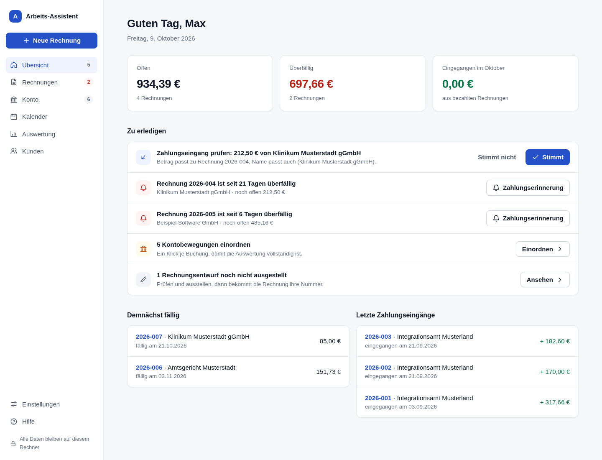
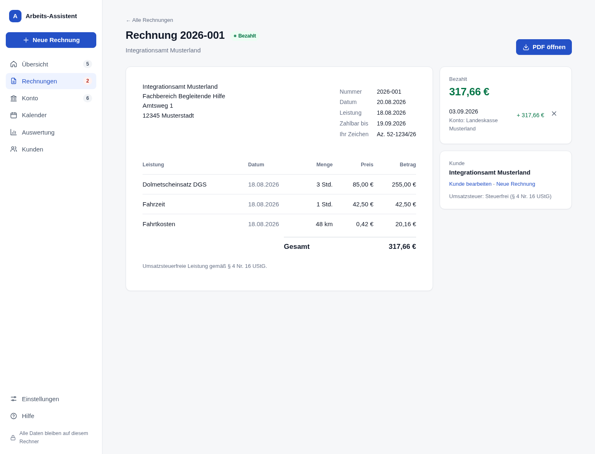
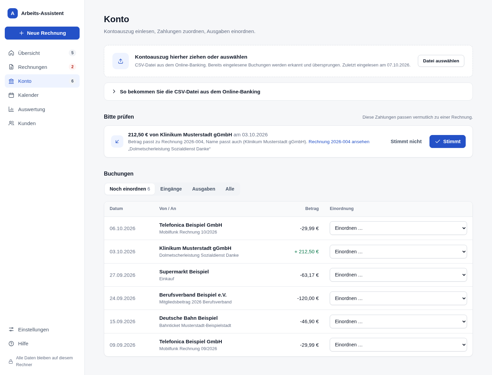

# Büroassistenz

**Rechnungen, Zahlungen, Mails · lokal mit eigener KI**

Rechnungen, Zahlungseingänge, Fristen und Arbeits-Mails für Selbstständige. Alles läuft auf
dem eigenen Mac, ohne Cloud und ohne Konto, auch die KI. Gebaut für einen freiberuflichen
Gebärdensprachdolmetscher (DGS), der mit sensiblen Daten arbeitet.



## Was sie kann

- **Rechnungen schreiben**
  - Kunden und Leistungen mit festen Preisen, fortlaufende Nummern im eigenen Format
    (z. B. `2026-09-147`).
  - Institutionskennzeichen (IK) und ein fester Text auf jeder Rechnung (z. B. Grundlage
    des Honorars nach JVEG), beides in den Einstellungen.
  - Vorgefertigte Leistungen pro Zeile auswählen, darunter optional eine Erläuterung
    (z. B. welcher Ausschuss).
  - Eingescannte Unterschrift: Foto oder Scan in den Einstellungen hochladen, sie steht
    dann über dem Namen.
  - Schrift der Rechnungen wählbar: Noto Sans (Standard) oder Arial. Schlusstext und
    Grußformel vor der Unterschrift stehen in den Einstellungen.
  - Rechnungsnummer beim Ausstellen: Das Programm schlägt die nächste vor, eine andere freie
    Nummer lässt sich eintragen. Nie verschickte Rechnungen (etwa Tests) lassen sich löschen,
    ihre Nummer wird wieder frei. Überweisungs-QR-Code abschaltbar. Rechnungsliste nach jeder
    Spalte sortierbar. Kunden ohne ausgestellte Rechnungen lassen sich löschen.
  - Zahlungsziel in Werktagen (Montag bis Freitag, ohne Feiertage des gewählten
    Bundeslands) oder Kalendertagen. Dateiname der gespeicherten PDFs frei wählbar.
  - Alte Rechnungen von vor dem Programm nachtragen, auf Wunsch aus dem PDF ausgelesen
    (E-Rechnung exakt, sonst die lokale KI als Vorschlag).
  - Das PDF hat einen Überweisungs-QR-Code und Pflichtangaben je nach Umsatzsteuerfall
    (steuerfrei nach § 4 Nr. 16 UStG, Kleinunternehmer oder 19 %).
  - Jedes PDF ist zugleich E-Rechnung nach ZUGFeRD 2 (Profil EN 16931, PDF/A-3 mit
    eingebetteter XML).
  - Ausgestellte Rechnungen bleiben unverändert. Fehler werden per Rechnungskorrektur
    berichtigt (neue Nummer, ersetzt die alte, Zahlungen gehen mit) oder per Storno
    aufgehoben.
- **Zahlungen erkennen:** Den Kontoauszug als CSV aus dem Online-Banking hineinziehen.
  - Zahlungen mit Rechnungsnummer und passendem Betrag werden automatisch zugeordnet,
    auch Sammelüberweisungen von Behörden.
  - Unsichere Fälle erscheinen zur Bestätigung.
- **Einnahmen:** Im Reiter Konto steht oben, wie viel im Jahr eingenommen wurde, mit
  Monatssäulen. Die Detailseite zeigt Monate, Kunden, Vergleich zum Vorjahr und was noch
  offen ist.
- **Im Blick behalten:**
  - Die Startseite zeigt, was zu tun ist: Zahlungen prüfen, Zahlungserinnerungen,
    Buchungen einordnen.
  - Der Kalender zeigt Einsätze, Fristen und Eingänge.
- **Mails lesen lassen:** Auf Wunsch liest eine KI auf dem Mac neue Mails mit (nur lesend) und erinnert an
  Rechnungen: „Einsatz am 14.10. abrechnen“ mit vorbereitetem Entwurf, Absagen (Ausfallhonorar?), Rückfragen
  zu einer Rechnung, angekündigte Zahlungen und Fristen. Sie ändert nie eine Rechnung, und keine Mail verlässt
  den Rechner.
- **Zum Jahresende:** Einnahmen und Ausgaben als Grundlage für die
  Einnahmen-Überschuss-Rechnung, als CSV für Steuerberatung oder ELSTER.

| Rechnung | Konto |
|---|---|
|  |  |

## Installation auf dem Mac

Das **Terminal** öffnen (Spotlight: „Terminal“) und diesen Befehl einfügen:

```bash
curl -fsSL https://raw.githubusercontent.com/TheQuidOne/bueroassistenz/main/installieren.sh | bash
```

Das Programm ist nach wenigen Minuten bereit und öffnet sich im Browser. Danach lädt das Skript
die lokale KI (Ollama mit dem Modell `gemma4:12b`, etwa 8 GB, nur einmal). Das kann 10–40 Minuten
dauern, das Programm lässt sich währenddessen schon benutzen. Es werden keine
Administratorrechte gebraucht, und Python muss nicht vorher installiert sein.
Ohne KI: denselben Befehl mit `| bash -s -- --ohne-ki` am Ende. Danach liegt **Büroassistenz**
unter „Programme“ und auf dem Schreibtisch. Das Programm startet bei jeder Anmeldung im
Hintergrund.

- **Aktualisieren:** derselbe Befehl. Daten, Einstellungen und die KI bleiben, wie sie sind.
  Das Programm startet dabei ein paar Sekunden neu.
- **Entfernen:** derselbe Befehl mit `| bash -s -- --entfernen` am Ende. Die Daten bleiben
  erhalten.
- **Ohne Terminal:** Auf GitHub **Code → Download ZIP** wählen und im entpackten Ordner
  `Installieren.command` doppelklicken. Blockiert macOS das, unter Systemeinstellungen →
  Datenschutz & Sicherheit „Dennoch öffnen“ wählen.
- Bis 2026-10-17 hieß das Programm „Arbeits-Assistent“. Der Datenordner
  `~/Arbeits-Assistent` und die Hintergrunddienste behalten diesen Namen, ein Update
  ersetzt nur das Programmsymbol.

## Aktualisieren

Am Mac das **Terminal** öffnen und diesen Befehl einfügen. Er holt die neueste Fassung von
GitHub und installiert sie:

```bash
curl -fsSL https://raw.githubusercontent.com/TheQuidOne/bueroassistenz/main/installieren.sh | bash
```

## Datenschutz

- Alle Daten liegen in `~/Arbeits-Assistent` auf diesem Mac:
  - Datenbank
  - ausgestellte Rechnungen als PDF
  - eingelesene Kontoauszüge
- **Mails:** Das Postfach wird nur gelesen. Nichts wird gelöscht, verschoben oder als gelesen
  markiert. Das Passwort liegt im Schlüsselbund des Macs, die KI läuft auf dem Mac (nur
  `127.0.0.1`).
- Das Programm überträgt nichts. Die Seite ist nur auf diesem Rechner erreichbar
  (`127.0.0.1`), fremde Webseiten können keine Formulare abschicken.
- Empfohlen: FileVault an und Time Machine auf eine verschlüsselte externe Festplatte.

## Bedienung

Im Programm unter **Hilfe** gibt es das Video-Tutorial und Antworten auf häufige Fragen.
Beim ersten Start führt die Startseite in fünf Schritten durch die Einrichtung:
1. Eigene Angaben eintragen.
2. Leistungen mit Preisen anlegen.
3. Den ersten Kunden anlegen.
4. Die erste Rechnung schreiben.
5. Den ersten Kontoauszug einlesen.

## Entwicklung

```bash
python3 -m venv .venv && .venv/bin/pip install -e '.[test]'
.venv/bin/python -m arbeitsassistent --demo   # erfundene Beispieldaten, http://127.0.0.1:8771
.venv/bin/python -m pytest -q                 # Tests
.venv/bin/python scripts/ki_pruefen.py gemma4:12b   # KI an erfundenen Mails messen (braucht Ollama)
```

- **Aufbau und Regeln für Agenten:** [AGENTS.md](AGENTS.md)
- **Entscheidungen, Stand und offene Fragen:** [docs/entscheidungen.md](docs/entscheidungen.md)
- **Video-Tutorial (HyperFrames):** [video/](video/)
